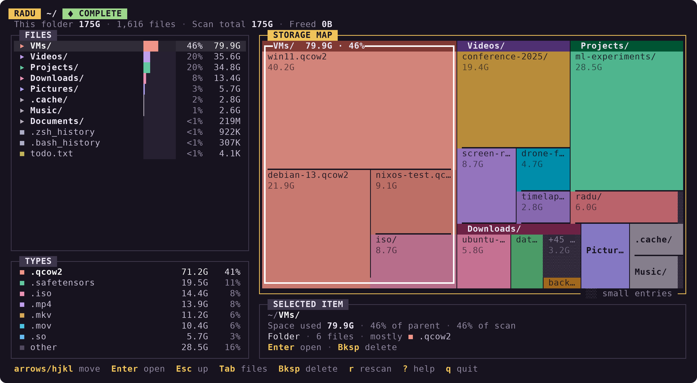
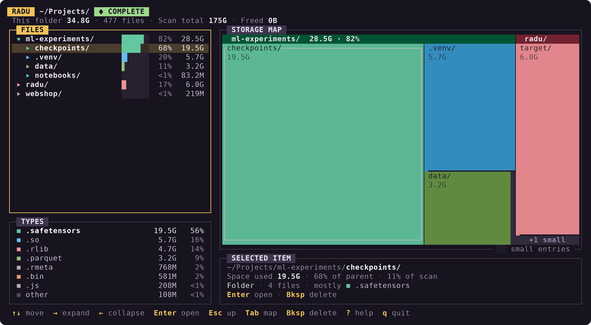

# RataDiskUsage

**`radu` shows what fills a disk, right in the terminal.** It draws a folder as a treemap coloured by file type, next to a file browser and a type legend, and keeps all three up to date while the scan is still running.



Built with [Ratatui](https://ratatui.rs). The screenshots show a demo folder.

## Highlights

- **A map you can read at a glance.** Tile area is space on disk, colour is file type, and folders show their contents as tiles inside them.
- **A file browser beside it.** The list and the map share one selection, so moving in either highlights the same entry in the other.
- **Live scanning.** The map fills in and rearranges as results arrive, and you can start exploring before the scan finishes.
- **Numbers you can trust.** Totals match `du`: allocated blocks, hard links counted once, symlinks never followed.
- **Fast.** A parallel scanner goes through 235,000 files under `/usr` in about 0.2 s on a warm cache.
- **Careful deletion.** Every delete asks first, and `--dry-run` lets you try the interface without touching the disk.
- **Fits your terminal.** 24-bit colour with a 256-colour fallback, a single-pane layout for narrow windows, and it works over SSH.

## Install

```sh
cargo install --git https://github.com/kinglevel/RataDiskUsage
```

Or from a checkout:

```sh
git clone https://github.com/kinglevel/RataDiskUsage
cd RataDiskUsage
cargo build --release      # the binary is target/release/radu
cargo install --path .     # optional: put radu on your PATH
```

Developed and tested with Rust 1.96 on Linux.

## Usage

```sh
radu                # scan the current folder
radu ~/Videos       # scan a specific folder
radu -x /           # scan the root filesystem only
radu --dry-run ~    # explore safely: deleting changes nothing on disk
```

| Option | Effect |
|---|---|
| `-x`, `--one-file-system` | Do not cross into other mounted filesystems |
| `-a`, `--apparent-size` | Count file lengths instead of space used on disk |
| `-j`, `--threads N` | Scanner threads (default: up to 8) |
| `--dry-run` | Deleting only removes entries from the view |
| `--no-motion` | No animations |
| `--color MODE` | `auto`, `truecolor` or `256` (default: `auto`) |
| `-h`, `--help` | Show help |
| `-V`, `--version` | Show the version |

## Reading the screen

**Storage map.** Each tile is a file or folder in the current folder.

- A tile twice as large takes twice the space.
- Colour is the file type. A folder takes the colour of the type that holds most of its bytes.
- Large folders show their own contents inside them, under a title strip.
- Brighter tiles hold a bigger share of their parent.
- Entries too small to draw are grouped into one hatched tile labelled `+N small`.

**Files.** The current folder, largest first, with each entry's share of its parent as a bar and a percentage. Folders can be expanded in place.

**Types.** The file types below the current folder, by total size. The type of the selected entry is highlighted.

**Selected item.** Path, size, share of the parent and of the whole scan, and what the entry mostly contains.



## Keys

| Key | Action |
|---|---|
| arrows / `hjkl` | Move between tiles, or between rows in the file list |
| `Enter` | Open the selected folder |
| `Esc` | Go up to the parent folder |
| `Tab` | Switch between the map and the file list |
| `→` / `←` | Expand or collapse a folder in the file list |
| `PgUp` `PgDn` `Home` `End` | Move through the file list |
| `Backspace` or `d` | Delete, after a y/n confirmation |
| `r` | Rescan the current folder |
| `?` | Show the key list |
| `q`, `Ctrl-C` | Quit |

The mouse works too: a click selects, a second click opens, and the wheel scrolls the file list.

## How sizes are counted

- Space used on disk (allocated blocks), the same number `du` reports. `--apparent-size` switches to file lengths.
- A file with several hard links is counted once.
- Symlinks are counted as the links they are and are never followed.
- `/proc`, `/sys`, `/dev` and `/run` are not walked when they are separate mounts.
- Folders that cannot be read are counted in the header as unreadable and marked red in the file list.
- Version and rotation suffixes are not treated as types: `libc.so.6` is a `.so` and `access.log.1` is a `.log`.

## Deleting

**Deleting is permanent. There is no trash.**

- `radu` asks for confirmation before every deletion and shows how much it frees.
- A symlink is removed as a link. What it points at is left alone.
- Deleting is disabled while a scan is running.
- `--dry-run` removes entries from the view only, and shows a `DRY RUN` marker in the header.

## Performance

Measured on the development machine with 8 scanner threads:

| Scan | Files | Time | Memory |
|---|---|---|---|
| `/usr`, warm cache | about 235,000 | about 0.2 s (`du -s`: 0.8 s) | |
| A whole disk, first pass | about 1.7 million | 18 s | 190 MB |

The interface redraws about 30 times a second while something is moving and uses no CPU when idle.

## Terminal support

- 24-bit colour is used when `COLORTERM` says the terminal supports it. Otherwise colours fall back to the 256-colour palette. `--color` overrides the detection.
- The font needs the Unicode box-drawing and block characters, which terminal fonts normally include.
- The smallest usable window is 30 columns by 12 rows. Below 64 columns the map and the file list share one pane and `Tab` switches between them.
- Tested on Linux only.

## Design

`radu` shares no code with the tools below, but borrows an idea from each:

| Tool | What `radu` takes from it |
|---|---|
| [diskonaut](https://github.com/imsnif/diskonaut) | Moving between tiles by position, Enter and Esc to walk the tree |
| [darya](https://github.com/mrkatebzadeh/darya) | The file browser with share bars and in-place expansion |
| [diskbloom](https://github.com/Zingzy/diskbloom) | Colour by file type, the type legend, folders drawn as a mosaic of their contents |
| [excise](https://github.com/findyourexit/excise) | The pane layout and the motion: tile transitions, the sheen on the selected tile, the dissolve on delete |

The interactive mockup that preceded the code is in [`design/mockup.html`](design/mockup.html).

## Roadmap

Not built yet: filtering, zoom, sort modes, exporting a scan, themes, and moving files to the trash instead of deleting them.

## Development

```sh
cargo test      # unit tests, including a comparison of totals against du
cargo clippy --all-targets
cargo fmt
```

| File | Contents |
|---|---|
| `src/scan.rs` | Parallel directory scanner |
| `src/tree.rs` | The scanned tree and its totals |
| `src/treemap.rs` | Squarified treemap layout |
| `src/app.rs` | State, navigation, transitions, deletion |
| `src/ui.rs` | Painting |
| `src/cells.rs` | Cell grid that frames are painted into |
| `src/color.rs` | Colours and the file-type palette |
| `src/fmt.rs` | Size formatting and width-aware truncation |
| `src/main.rs` | Arguments and the event loop |
